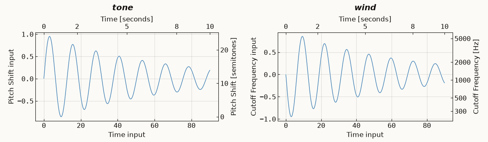

.. _inspecting:

Representing Sonifications
##########################

.. versionadded:: 1.5
   Tables and mapping plots of a sonification, and provisional animation.

Tables and plots can be generated to illustrate how each sonification in an audio figure communicates its input data, showing the values each sound parameter takes to represent each source across its duration. As elsewhere, let's first make a simple audio figure:

.. code-block:: python

   import numpy as np
   import strauss

   x = np.linspace(0, 90, 400)
   y = np.sin(x/2) * np.exp(-x/60)

   strauss.sonify(x, y, name='tone')
   strauss.sonify(x, -y, style='windy', name='wind')

Note: Each function below can also be applied to an ``AudioFigure`` explicitly using a method with the same name (see :doc:`audio_figure`). Where a figure combines multiple sonifications, you can provide the ``name`` of which one you want to inspect.

Tables
******

``list_tables`` prints the individual tables available, for each sonification:

.. code-block:: python

   strauss.list_tables()

.. code-block:: text

   	1.	 tone (Objects)
   		 - source_0 (C2)
   	2.	 wind (Objects)
   		 - source_0 (C2)

``get_table`` then returns a ``pandas`` DataFrame of the mapped values, using the set units of each parameter, and ordered chronologically:

.. code-block:: python

   strauss.get_table('tone')

.. code-block:: text

          Time Pitch Shift
     [seconds] [semitones]
   0      0.00       11.37
   1      0.03       12.86
   2      0.05       14.32
   ...

With ``include_input=True``, each parameter also gets a column of the input data it was mapped from.

The table format depends on the treatment of sources by the given style. There are two main types:

* **Events**: Where each data point is treated as a discrete, transient event in time. One table is made per sonification, with a row for each event giving its source, time, note, given name, and mapped values. Events that are merged together by ``max_notes_per_sec`` are indicated and show their aggregated properties. Those filled in by ``handle_nans``, are also indicated.
* **Objects**: One table for each source (such that a sonification can have multiple tables), referenced per ``source`` using its name or index, with a row corresponding to each data point along its evolution. The ``source`` variable can be left out for single-source sonifications.

.. code-block:: python

   strauss.close()
   strauss.sonify(x, y, style='flute_section')
   table = strauss.get_table(source=0)
   table.attrs

.. code-block:: text

   {'source': 'source_0', 'note': 'G2', 'note_frequency': 97.99885899543733, 'sample': 'G2'}

Sources are named ``source_0``, ``source_1``, ... unless provided with custom ``source_names`` when sonifying.

Parameters that are explicitly held fixed per sonification or source (i.e. aren't mapped by the data) are listed using ``get_fixed_table`` instead, showing the fixed value used for each, and whether it was ``fixed`` by the style, a keyword, or set automatically (``auto``). Without a ``source`` specified, parameters that differ between sources, like each flute's note, are left out:

.. code-block:: python

   strauss.get_fixed_table(source=0)

.. code-block:: text

     parameter value unit origin
   0      Note    G2        auto

Visualising sonifications
*************************

The ``plot_mapping`` function shows how each sonification maps input (source) data to the sound parameters used to represent it. By default, the *x*-axes are reserved for time mappings and *y*-axes for any other parameters. Bottom and left axes show the input data in their input units, while the top and right axes show how plotted data values get scaled to their mapped parameter ranges: namely occurence time in the sonification along the top, and expressive sound properties along the right.

.. code-block:: python

   strauss.close()
   strauss.sonify(x, y, name='tone')
   strauss.sonify(x, -y, style='windy', name='wind')
   strauss.plot_mapping(theme='light')

Events are drawn as points (to represent their discrete nature) and objects as lines (as these are continuous), named in a legend where there are several sources. Fixed parameters are left out. Options passable to the ``plot_mapping`` function include:

* ``name``: passing a sonification's name, or a list of them, plots only those.
* ``per_source``: boolean flag, whether to give each object source its own panel.
* ``theme``: ``'dark'`` (the default) or ``'light'``.
* ``waveform``: show the rendered sonification's waveforms below each column.
* ``panel_size``: the specific width and height of each panel in inches, e.g. ``(6, 4)``
* ``title``: a title to give the plotted figure.
* ``show=False``: to return the figure without showing it.

Animation (provisional)
***********************

``animate_mapping`` runs a playhead across the mapping plot as the audio plays. Given a file name, it writes a video with the figure's audio, via ``ffmpeg`` provided it is available. Save or display the figure first, so its audio is rendered (animate mapping should also render the audio if it hasn't been, but this is not yet implemented):

.. code-block:: python

   strauss.save('mix.wav')
   strauss.animate_mapping(fname='mix.mp4')

Without a file name, this returns a ``matplotlib`` animation to preview the result cheaply. This gets shown in a notebook environment, but will be silent.
